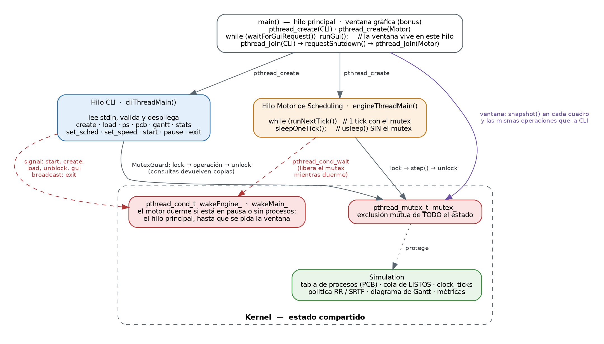

# Simulador de Kernel y Gestor de Procesos en Consola

**Shell & Scheduling Engine** — Proyecto de Sistemas Operativos, Fase I · Universidad Católica Andrés Bello, Escuela de Ingeniería Informática · Cátedra Sistemas Operativos (Prof. Marcel J. Castro G.)

Simulador, en C++17, del núcleo ejecutor de un sistema operativo de bajo consumo. Dos hilos POSIX trabajan en paralelo sobre una tabla de procesos protegida con `pthread_mutex_t`:

- **Hilo CLI**: una shell interactiva que valida estrictamente cada comando y nunca se cae ante entradas inválidas.
- **Hilo Motor de Scheduling**: un reloj de CPU discreto (*clock ticks*) que planifica los procesos con **Round Robin** o **SRTF apropiativo**, intercambiables en caliente.

Incluye el ciclo de vida completo del proceso con su **PCB** (NEW → READY → RUNNING → BLOCKED → TERMINATED), **carga por lotes** de archivos de traza, **diagrama de Gantt** y **métricas reales** (espera, retorno, respuesta y uso de CPU).

## Requisitos

- Linux, WSL (Windows) o macOS.
- `g++` o `clang++` con soporte C++17 e hilos POSIX (`-pthread`).
- `make` (o CMake ≥ 3.16 como alternativa).

## Compilación y ejecución

```bash
make            # compila ./simulador
./simulador     # abre la shell interactiva
```

Otros objetivos:

```bash
make test       # 66 pruebas unitarias
make e2e        # 5 escenarios contra el ejecutable real (incluye los del enunciado)
make tsan       # todo lo anterior bajo ThreadSanitizer (detecta condiciones de carrera)
make clean
```

Con CMake:

```bash
cmake -S . -B build-cmake && cmake --build build-cmake
ctest --test-dir build-cmake --output-on-failure
./build-cmake/simulador
```

## Comandos de la shell

| Comando | Descripción |
|---------|-------------|
| `create <nombre> <burst_time> [prioridad]` | Crea un proceso (prioridad 1–5, defecto 3), le asigna un PID autoincremental y lo ingresa a la cola de LISTOS. |
| `load <archivo>` | Carga por lotes un archivo de traza respetando los tiempos de llegada. Valida el archivo completo antes de crear procesos. |
| `ps` | Tabla con PID, nombre, estado, ráfaga restante y prioridad, más el reloj, la política y la cola de LISTOS. |
| `pcb <PID>` | Detalle del Process Control Block: llegada, ráfaga inicial y restante, espera, retorno y respuesta. |
| `set_sched <RR\|SRTF> [quantum]` | Cambia la política de planificación, incluso con el motor en marcha. Para `RR` el quantum es opcional (defecto 2). |
| `set_speed <ms_por_tick>` | Duración real de cada tick de CPU, entre 50 y 5000 ms (defecto 1000). |
| `start` / `pause` | Inicia o reanuda / detiene el reloj de CPU. |
| `block <PID>` / `unblock <PID>` | Lleva un proceso a PAUSADO/BLOQUEADO y lo devuelve a LISTOS. |
| `gantt` | Diagrama de Gantt acumulado hasta el instante actual. |
| `stats` | Procesos finalizados, promedios de espera, retorno y respuesta, uso de CPU. |
| `help` | Manual rápido. |
| `exit` | Detiene los hilos de forma limpia, libera la memoria y sale. |

Errores de sintaxis, de tipo o de rango se informan con el formato del enunciado (`[ERROR DE SINTAXIS]`, `[ERROR DE TIPO]`, `[ERROR DE PARAMETRO]`, …) y la shell solicita la siguiente entrada.

## Ejemplos

**Escenario 2 del enunciado** (carga por lotes con SRTF):

```text
> set_sched SRTF
[OK]: Política de planificación: SRTF (apropiativo).
> load workloads/workload_test.txt
[OK]: 3 proceso(s) cargado(s) desde 'workloads/workload_test.txt' (llegadas relativas a t=0):
  PID 1   Job_A  ráfaga=4  prioridad=2  llegada=t0  -> READY
  PID 2   Job_B  ráfaga=2  prioridad=1  llegada=t1  -> NEW
  PID 3   Job_C  ráfaga=1  prioridad=3  llegada=t3  -> NEW
> start
...
> gantt
DIAGRAMA DE GANTT (0 - 7 ticks):
[0-1s: Job_A] -> [1-3s: Job_B] -> [3-4s: Job_C] -> [4-7s: Job_A]
> stats
ESTADÍSTICAS DEL SISTEMA:
- Procesos Finalizados        : 3 / 3
- Tiempo Promedio de Espera   : 1.00 ticks
- Tiempo Promedio de Retorno  : 3.33 ticks
- Tiempo Promedio de Respuesta: 0.00 ticks
- Uso de CPU                  : 100.0%
- Tiempo Total Simulado       : 7 ticks
```

**Escenario 1** (Round Robin, quantum 2) con `create P1 5 2`, `create P2 3 1`, `create P3 2 3` y `start`:

```text
DIAGRAMA DE GANTT (0 - 10 ticks):
[0-2s: P1] -> [2-4s: P2] -> [4-6s: P3] -> [6-8s: P1] -> [8-9s: P2] -> [9-10s: P1]
```

Los guiones de `tests/e2e/` reproducen ambos escenarios completos (incluida la pausa, el `pcb 1` y el cambio en caliente a SRTF) y guardan su transcripción en `tests/e2e/out/`.

## Archivo de traza (`load`)

Una línea por proceso, campos separados por coma. Las líneas vacías y las que empiezan con `#` se ignoran.

```text
# NOMBRE, BURST_TIME, PRIORIDAD, ARRIVAL_TIME
Job_A, 4, 2, 0
Job_B, 2, 1, 1
Job_C, 1, 3, 3
```

Los tiempos de llegada son **relativos al instante de la carga** (si se carga en t=0, coinciden con los del archivo). En `workloads/` hay tres trazas: la del enunciado, una carga mixta con un periodo ocioso y un archivo con errores a propósito para demostrar la validación.

## Arquitectura



- `main` crea el `Kernel` (estado compartido) y lanza los dos hilos con `pthread_create`; al recibir `exit` los espera con `pthread_join` y libera la memoria.
- **Un único `pthread_mutex_t`** protege todo el estado (tabla de procesos, cola de LISTOS, reloj, Gantt, banderas). Cada operación lo toma y lo suelta mediante `MutexGuard` (RAII sobre `pthread_mutex_lock`/`pthread_mutex_unlock`).
- El motor duerme en un `pthread_cond_t` cuando está en pausa o no hay procesos, y hace el retardo real de cada tick (`usleep`) **sin** el mutex, así la CLI responde de inmediato.
- Las consultas (`ps`, `pcb`, `gantt`, `stats`) trabajan sobre copias tomadas en una sola sección crítica.
- La lógica de planificación (`Simulation` + `SchedulingPolicy`) no conoce los hilos: se prueba de forma determinista avanzando tick a tick.

El detalle (estructura modular, modelo de procesos, algoritmos, pruebas y anexo de uso de IA) está en el **[Informe Técnico](docs/informe_tecnico.pdf)** ([fuente en Markdown](docs/informe_tecnico.md)).

### Convenciones de planificación

- El tick *t* representa el intervalo `[t, t+1)`. En cada tick se admiten las llegadas, decide la política, el proceso en ejecución consume una unidad de ráfaga y los procesos LISTOS acumulan espera.
- **Round Robin**: al agotar el quantum, el proceso vuelve al final de la cola, *después* de los que llegaron en ese mismo instante. Si nadie espera, continúa con un quantum nuevo.
- **SRTF**: ejecuta el proceso con menor ráfaga restante y desaloja de inmediato al actual si llega uno estrictamente menor. Desempates: prioridad (1 es la más alta), llegada y PID.
- El tiempo de espera cuenta solo los ticks en la cola de LISTOS (no los bloqueados).

## Estructura del repositorio

```text
include/   cabeceras (.hpp) documentadas
src/       implementación (.cpp)
tests/     pruebas unitarias (mini framework propio) y escenarios e2e en Bash
workloads/ archivos de traza para `load`
docs/      informe técnico (PDF y Markdown), diagramas
Makefile, CMakeLists.txt, .github/workflows/ci.yml
```

## Flujo de trabajo en GitHub

- `main`: versión estable de entrega (solo recibe `dev` cuando el equipo lo aprueba).
- `dev`: rama de integración; cada módulo llega por pull request desde su rama `feature/*`.
- Cada pull request cierra su issue, ejecuta la integración continua (compilación, pruebas, ThreadSanitizer y escenarios) y se mueve en el tablero Kanban **Por hacer → Haciendo → Completado**.

## Equipo y responsables por módulo

| Integrante | Módulos (issues asignados) |
|------------|----------------------------|
| Roberto Ferrer | Estructura y compilación · Concurrencia (hilos y mutex) · Motor de scheduling con Round Robin · Bloqueo de procesos |
| Mario Sanches | PCB y tabla de procesos · SRTF apropiativo · Diagrama de Gantt y métricas · Carga por lotes |
| Samantha Castro | Parser y validación · Comandos de la CLI · Pruebas de escenarios · Documentación |

## Uso de Inteligencia Artificial

Este proyecto se desarrolló con asistencia de Claude (Anthropic). La declaración completa —herramienta, prompts principales y forma de validación— está en el Anexo A del [informe técnico](docs/informe_tecnico.md#anexo-a-declaración-del-uso-de-inteligencia-artificial).
