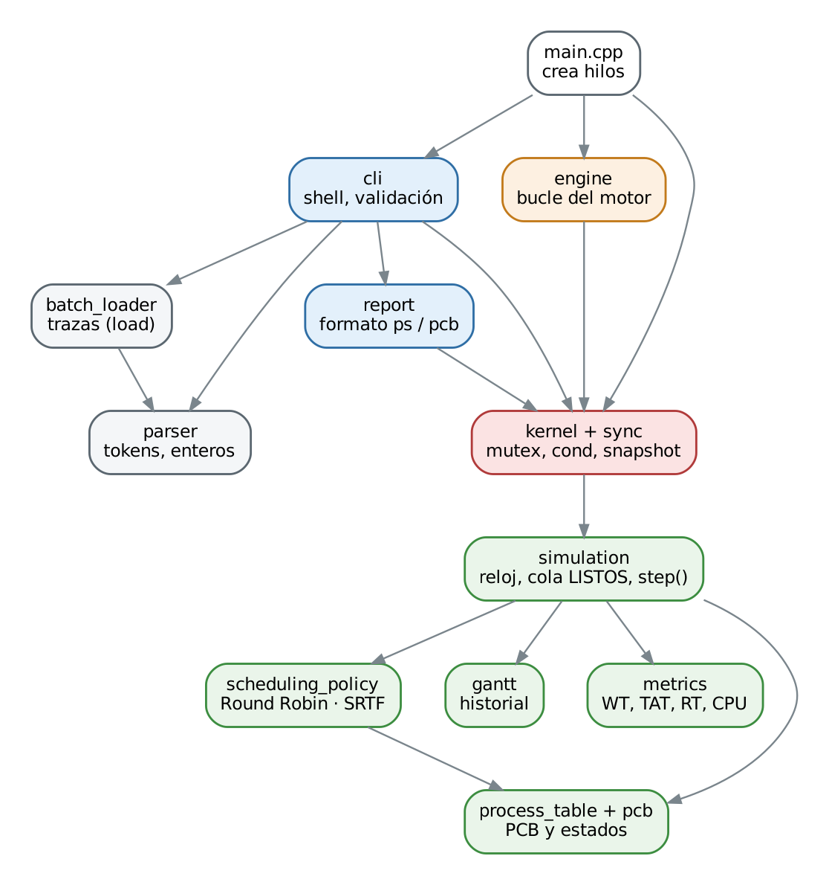
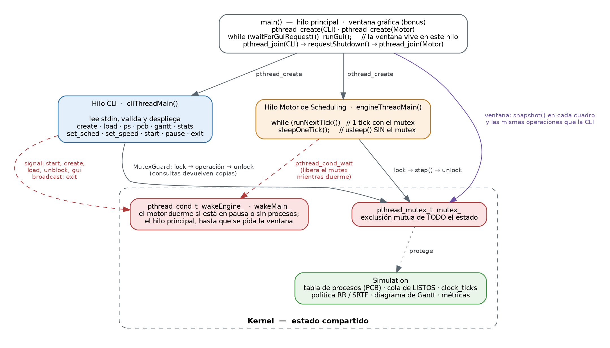
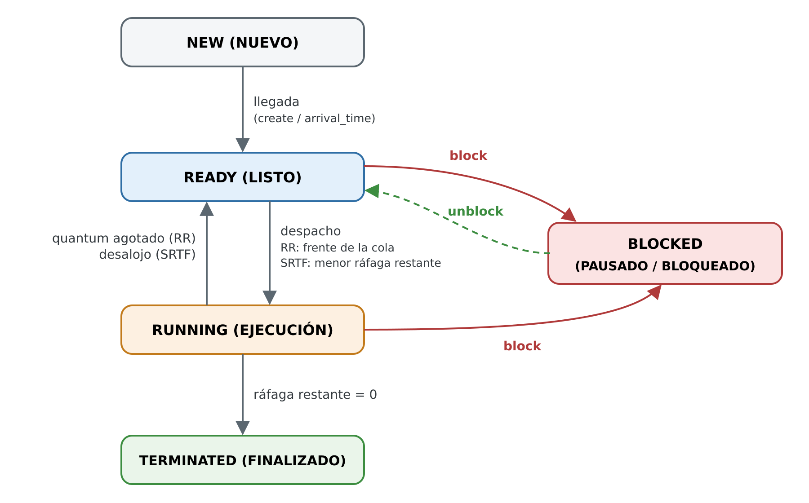

# 1. Introducción

Este informe describe la arquitectura del simulador desarrollado para la Fase I del proyecto: el núcleo ejecutor de un sistema operativo de bajo consumo, formado por una **shell interactiva de gestión** y un **motor de planificación de CPU** que se ejecutan de forma concurrente con hilos POSIX. El sistema simula la creación de procesos, su ciclo de vida, el mantenimiento del *Process Control Block* (PCB), la planificación con **Round Robin** y **SRTF apropiativo**, la carga por lotes de trazas y el cálculo de métricas de rendimiento.

El código está escrito en C++17, se compila con `g++ -pthread` (o `clang++`) mediante `Makefile` o `CMakeLists.txt`, y se ejecuta en Linux, WSL o macOS.

# 2. Estructura modular del código

El proyecto separa la **lógica de planificación** (determinista, sin hilos) de la **capa de concurrencia** y de la **interfaz**. Cada módulo tiene su cabecera documentada en `include/` y su implementación en `src/`.

| Módulo | Responsabilidad principal | Capa |
|----------------------|-------------------------------------------------------------|------------|
| `pcb` | Estructura `PCB`, enum `ProcessState`, constantes de prioridad | Modelo |
| `process_table` | Dueña de los PCB (memoria dinámica con `std::unique_ptr`), PID autoincremental | Modelo |
| `scheduling_policy` | Interfaz `SchedulingPolicy` (patrón *Strategy*), `RoundRobinPolicy`, `SrtfPolicy`, despacho y desalojo | Planificación |
| `simulation` | Reloj discreto, cola de LISTOS, admisión de llegadas, `step()` de un tick, bloqueo | Planificación |
| `gantt` / `metrics` | Historial de ejecución por tramos; promedios de espera, retorno, respuesta y uso de CPU | Métricas |
| `sync` | `MutexGuard`: cerrojo RAII sobre `pthread_mutex_lock` / `pthread_mutex_unlock` | Concurrencia |
| `kernel` | Estado compartido: `Simulation` + `pthread_mutex_t` + `pthread_cond_t` + banderas del motor | Concurrencia |
| `engine` | Función del Hilo Motor (`engineThreadMain`) | Concurrencia |
| `cli` / `report` | Hilo CLI: tabla de comandos, validación estricta, mensajes de error; formato de `ps` y `pcb` | Interfaz |
| `parser` / `batch_loader` | Tokenizador, enteros estrictos, nombres; lectura y validación de trazas | Utilidades |
| `main.cpp` | Crea el `Kernel` y los dos hilos; cierre ordenado y liberación de memoria | Arranque |

{width=55%}

La clase `Simulation` no usa hilos ni temporizadores: avanza exactamente un tick por llamada a `step()`. Esto permite verificar los algoritmos con pruebas unitarias deterministas. La clase `Kernel` envuelve a `Simulation` y agrega la sincronización; el resto del programa nunca toca el estado sin pasar por ella.

# 3. Arquitectura concurrente y sincronización

{width=92%}

**Hilos.** El hilo principal crea el `Kernel` y lanza dos hilos con `pthread_create`: el **Hilo CLI** (`cliThreadMain`), que lee y valida comandos, y el **Hilo Motor de Scheduling** (`engineThreadMain`), que simula el reloj de CPU. Al terminar la CLI (`exit` o fin de la entrada), `main` pide el apagado del motor, lo espera con `pthread_join` y libera la memoria dinámica de los PCB.

**Exclusión mutua.** Un único `pthread_mutex_t` protege **todo** el estado compartido: tabla de procesos, cola de LISTOS, reloj, historial de Gantt y banderas de control. Cada método público del `Kernel` abre una sección crítica con `MutexGuard`, que llama a `pthread_mutex_lock` en su constructor y a `pthread_mutex_unlock` en su destructor, de modo que el cerrojo se libera en todos los caminos de salida. Al existir un solo cerrojo, que nunca se toma de forma anidada, no puede haber espera circular y, por tanto, tampoco interbloqueos.

**Variable de condición.** Cuando el reloj está en pausa o no quedan procesos sin terminar, el motor espera en `pthread_cond_wait`, que libera el mutex mientras duerme. La espera está dentro de un `while` que vuelve a comprobar la condición, lo que cubre los despertares espurios. La CLI despierta al motor con `pthread_cond_signal` en `start`, `create`, `load` y `unblock`, y con `pthread_cond_broadcast` en `exit`.

**Retardo real fuera de la sección crítica.** Cada tick se ejecuta completo con el mutex tomado (`runNextTick` → `step`), lo que dura microsegundos. El retardo de `set_speed` se hace después y **sin** el mutex, con `usleep` en tramos de 10 ms; entre tramos se consultan las banderas, de modo que `pause`, `exit` y los cambios de velocidad surten efecto en menos de 10 ms aunque el tick dure 5000 ms. Así la CLI nunca queda bloqueada por el motor.

**Consultas por copia.** `ps`, `pcb`, `gantt` y `stats` obtienen una copia consistente del estado (`SystemSnapshot`) en una sola sección crítica y le dan formato fuera de ella. Solo el Hilo CLI escribe en la consola, por lo que las salidas no se mezclan.

La ausencia de condiciones de carrera se verificó con **ThreadSanitizer** (`make tsan`), que ejecuta las pruebas unitarias —incluida una prueba de estrés con consultas, creaciones y cambios de política concurrentes— y los escenarios completos sin reportar ningún acceso conflictivo.

# 4. Modelo de procesos (PCB)

| Campo del PCB | Significado |
|------------------------------|--------------------------------------------------------|
| `pid`, `name`, `priority` | Identidad (PID autoincremental desde 1), nombre sin espacios y prioridad 1 (más alta) a 5 |
| `state` | NEW, READY, RUNNING, BLOCKED o TERMINATED |
| `arrivalTime` | Tick de llegada al sistema |
| `burstTotal`, `burstRemaining` | Ráfaga inicial y ráfaga restante |
| `startTime`, `finishTime` | Primer uso de CPU y finalización (−1 mientras no ocurren) |
| `waitingTime` | Ticks acumulados en la cola de LISTOS |
| `quantumUsed` | Ticks consumidos en la porción actual (Round Robin) |

{width=68%}

Un proceso creado con `create` llega en el instante actual y pasa de NEW a READY de inmediato. Uno cargado con `load` permanece en NEW hasta que el reloj alcanza su tiempo de llegada. Los comandos `block` y `unblock` implementan el estado PAUSADO/BLOQUEADO: un proceso bloqueado sale de la CPU o de la cola y, al desbloquearse, vuelve al final de la cola de LISTOS.

# 5. Planificación y manejo del tiempo

**Reloj discreto.** El tiempo del sistema es el entero `clock_ticks`; el tick *t* representa el intervalo [*t*, *t*+1). Cada llamada a `Simulation::step()`:

1. admite las llegadas del instante *t* y deja que la política decida quién usa la CPU;
2. descuenta una unidad de ráfaga al proceso en ejecución y registra el tick en el Gantt (o un tick ocioso);
3. suma un tick de espera a cada proceso de la cola de LISTOS;
4. avanza el reloj a *t*+1 y, si la ráfaga llegó a cero, marca el proceso como TERMINATED en *t*+1;
5. vuelve a decidir para *t*+1, de modo que `ps` y `pcb` muestren quién tiene la CPU en el instante actual.

La política es idempotente: repetir la decisión en el mismo instante no la altera, salvo que la CLI haya cambiado algo entre ticks (un proceso nuevo, un cambio de política), en cuyo caso se aplica antes de ejecutar el siguiente tick. El reloj no avanza en pausa ni cuando todos los procesos terminaron.

**Round Robin.** La cola de LISTOS es FIFO. El proceso en ejecución conserva la CPU hasta agotar su quantum; entonces vuelve al final de la cola, detrás de los procesos que llegaron en ese mismo instante. Si nadie espera, continúa con un quantum nuevo. Las llegadas no desalojan al proceso en ejecución.

**SRTF apropiativo.** Siempre ejecuta el proceso con menor ráfaga restante. Si llega o se desbloquea un proceso con ráfaga restante estrictamente menor que la del proceso en ejecución, este es desalojado de inmediato. Los empates se resuelven por prioridad (criterio de prioridades apropiativo), luego por llegada y por PID; con igual ráfaga e igual prioridad no se desaloja, para evitar cambios de contexto inútiles.

**Cambio en caliente.** `set_sched` reemplaza el objeto de política bajo el mutex; el proceso en ejecución inicia una porción nueva y la siguiente decisión ya usa el algoritmo nuevo.

**Métricas.** Para cada proceso finalizado: retorno TAT = instante de fin − llegada; espera WT = ticks en la cola de LISTOS (igual a TAT − ráfaga si nunca se bloqueó); respuesta RT = primer uso de CPU − llegada. `stats` muestra sus promedios sobre los procesos finalizados y el uso de CPU = ticks ocupados / ticks simulados × 100.

**Escenario 2 (SRTF, carga por lotes).** En *t* = 1 llega Job_B (ráfaga 2) y desaloja a Job_A, al que le quedan 3. El Gantt obtenido es exactamente el exigido por el enunciado: `[0-1s: Job_A] -> [1-3s: Job_B] -> [3-4s: Job_C] -> [4-7s: Job_A]`.

| Proceso | Llegada | Ráfaga | Prioridad | Fin | TAT | WT | RT |
|:--------|:-------:|:------:|:---------:|:---:|:---:|:--:|:--:|
| Job_A | 0 | 4 | 2 | 7 | 7 | 3 | 0 |
| Job_B | 1 | 2 | 1 | 3 | 2 | 0 | 0 |
| Job_C | 3 | 1 | 3 | 4 | 1 | 0 | 0 |
| **Promedio** | | | | | **3,33** | **1,00** | **0,00** |

**Escenario 1 (Round Robin, quantum 2).** Sin interrupciones el Gantt es `[0-2s: P1] -> [2-4s: P2] -> [4-6s: P3] -> [6-8s: P1] -> [8-9s: P2] -> [9-10s: P1]`. Si se pausa en *t* = 3 y se cambia a SRTF, el resultado es `[0-2s: P1] -> [2-5s: P2] -> [5-7s: P3] -> [7-10s: P1]`; ambos casos están cubiertos por pruebas automáticas.

| Proceso | Llegada | Ráfaga | Prioridad | Fin | TAT | WT | RT |
|:--------|:-------:|:------:|:---------:|:---:|:---:|:--:|:--:|
| P1 | 0 | 5 | 2 | 10 | 10 | 5 | 0 |
| P2 | 0 | 3 | 1 | 9 | 9 | 6 | 2 |
| P3 | 0 | 2 | 3 | 6 | 6 | 4 | 4 |
| **Promedio** | | | | | **8,33** | **5,00** | **2,00** |

# 6. Shell interactiva y validación de entradas

El Hilo CLI separa cada línea en palabras (admite comillas dobles para rutas con espacios), busca el comando en una tabla que define cuántos parámetros acepta y su sintaxis de uso, y valida cada valor antes de tocar el `Kernel`. Los enteros se interpretan de forma estricta: se rechazan `"abc"`, `"2.5"`, `"5x"` o valores que no caben en un `int`. Ningún error detiene la simulación; además, cada comando se ejecuta dentro de un `try/catch` como red de seguridad.

| Categoría | Cuándo se produce | Ejemplo |
|-----------------------|----------------------------------------------|---------------------------|
| `[ERROR DE SINTAXIS]` | Faltan o sobran parámetros; comillas sin cerrar | `create Proceso_A`, `ps extra` |
| `[ERROR DE TIPO]` | Se esperaba un entero | `pcb abc`, `create P1 cinco` |
| `[ERROR DE PARAMETRO]` | Valor fuera de rango, algoritmo desconocido, PID inexistente | `set_sched FIFO`, `set_speed 10`, `pcb 99` |
| `[ERROR DE ARCHIVO]` / `[ERROR DE FORMATO]` | La traza no existe o tiene líneas inválidas (se informan todas con su número de línea y no se carga nada) | `load no_existe.txt` |
| `[ERROR]` | Comando no reconocido (sugiere el correcto si solo difiere en mayúsculas) | `fork`, `PS` |

Si la entrada estándar no es una terminal, la shell repite cada comando en la salida, de modo que una sesión guionizada produce una transcripción legible. Al llegar al fin de la entrada sin `exit`, el sistema se cierra igual de forma ordenada.

# 7. Pruebas y verificación

| Verificación | Cómo se ejecuta | Resultado |
|---------------------------------------------|------------------------------|--------------------|
| 66 pruebas unitarias (PCB, parser, RR, SRTF, Gantt, métricas, Kernel con hilos, CLI, lotes, bloqueo) | `make test` | 66/66 |
| 5 escenarios contra el ejecutable real (Escenarios 1 y 2, robustez de la CLI, bloqueo y cierre) | `make e2e` | 5/5 |
| Condiciones de carrera | `make tsan` (ThreadSanitizer, unitarias + escenarios) | Sin reportes |
| Fugas de memoria | Valgrind sobre el Escenario 2 completo | 0 bytes en uso al salir |
| Portabilidad y advertencias | g++ 13 y clang++ con `-Wall -Wextra -Wpedantic -Wshadow`; Makefile y CMake | Sin advertencias |
| Integración continua | GitHub Actions en cada pull request hacia `dev` | Compila, prueba, TSan y escenarios |

# 8. Gestión del proyecto

El repositorio usa la rama `main` para la versión de entrega, la rama `dev` para la integración y una rama `feature/*` por issue. Cada módulo se integró a `dev` mediante un pull request que cierra su issue y pasa la integración continua; `main` solo recibirá `dev` cuando el equipo lo apruebe. Los issues están etiquetados por módulo y por responsable, agrupados en el hito *Fase 1*, y el tablero Kanban de GitHub Projects los organiza en las columnas **Por hacer**, **Haciendo** y **Completado**.

| Responsable | Issues |
|------------------|---------------------------------------------------------------------------|
| Roberto Ferrer | Estructura y compilación con CI · Arquitectura concurrente (hilos y mutex) · Motor de scheduling con Round Robin · Bloqueo de procesos |
| Mario Sanches | PCB y tabla de procesos · SRTF apropiativo y cambio en caliente · Diagrama de Gantt y métricas · Carga por lotes |
| Samantha Castro | Parser y validación estricta · Comandos de la CLI · Pruebas de los escenarios · Documentación e informe |

# 9. Referencias bibliográficas

1. Silberschatz, A., Galvin, P. B. y Gagne, G. (2018). *Operating System Concepts* (10.ª ed.). Wiley. Capítulos 3 (procesos), 4 (hilos), 5 (planificación de CPU) y 6–7 (sincronización).
2. Tanenbaum, A. S. y Bos, H. (2015). *Modern Operating Systems* (4.ª ed.). Pearson. Capítulo 2 (procesos e hilos, planificación).
3. Stallings, W. (2018). *Operating Systems: Internals and Design Principles* (9.ª ed.). Pearson. Capítulo 9 (planificación de uniprocesador).
4. Arpaci-Dusseau, R. H. y Arpaci-Dusseau, A. C. (2018). *Operating Systems: Three Easy Pieces*. Arpaci-Dusseau Books. Capítulos 7–8 (planificación) y 26–30 (concurrencia, cerrojos y variables de condición).
5. Butenhof, D. R. (1997). *Programming with POSIX Threads*. Addison-Wesley.
6. Kerrisk, M. (2010). *The Linux Programming Interface*. No Starch Press. Capítulos 29–33 (hilos POSIX).
7. IEEE y The Open Group (2018). *IEEE Std 1003.1-2017 (POSIX.1-2017)*: `pthread_create`, `pthread_join`, `pthread_mutex_lock`, `pthread_cond_wait`, `usleep`.

# Anexo A. Declaración del uso de Inteligencia Artificial

**Herramienta utilizada.** Claude (Anthropic), modelo Claude Opus 5.5, usado desde claude.ai en modo agente, con acceso a una terminal Linux y al repositorio de GitHub del equipo.

**Forma de uso.** La herramienta actuó como asistente de desarrollo e implementación. A partir del enunciado (PDF adjunto) y de las instrucciones del equipo, generó el código fuente, las pruebas automatizadas, este informe y la organización del repositorio: ramas, issues, pull requests y tablero. El equipo indicó sus integrantes y el flujo de trabajo en GitHub (rama `main`, rama `dev` y ramas `feature/*` integradas mediante pull requests); la herramienta propuso la división en módulos y la asignación de issues.

**Prompt principal** (textual, acompañado del enunciado en PDF):

> Crea el repositorio del github tu, haz el proyecto y subelo a github. En el area del proyecto pon las cartas de "Por hacer", "haciendo" y "completado". Necesito que crees los issues y le asignes los issues necesarios a cada uno "Mario Sanches", "Roberto Ferrer" y a "Samantha Castro". Cada vez que hagas codigo ve haciendolo mediante un pull request. Vas a hacer dos ramas, la "main", la deb y las ramas features que es donde vas a hacer el codigo y vas a hacer el pr a la rama deb pero aun no lances nada a main

**Validación realizada durante el desarrollo.** Los resultados se contrastaron con cálculos manuales y con las salidas esperadas del enunciado mediante 66 pruebas unitarias deterministas y 5 escenarios ejecutados contra el binario real; se verificó la ausencia de condiciones de carrera con ThreadSanitizer y la ausencia de fugas con Valgrind, y se compiló sin advertencias con g++ y clang++.
Cada pull request ejecuta esta batería en GitHub Actions.

**Validación y apropiación por parte del equipo** (completar antes de la entrega):

- [ ] Cada integrante revisó el código de sus issues y puede explicarlo en la defensa individual.
- [ ] Se reprodujeron manualmente los Escenarios 1 y 2 y se compararon con el cálculo a mano del Gantt y las métricas.
- [ ] Se registraron aquí los prompts adicionales usados durante la revisión, si los hubo.
- [ ] Observaciones del equipo sobre los resultados aportados por la herramienta: …
